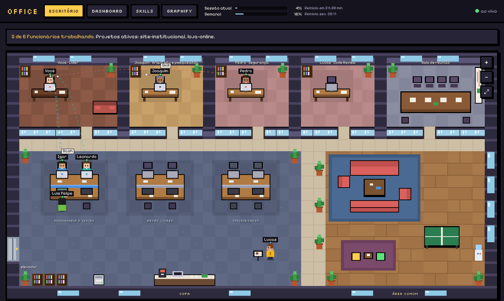
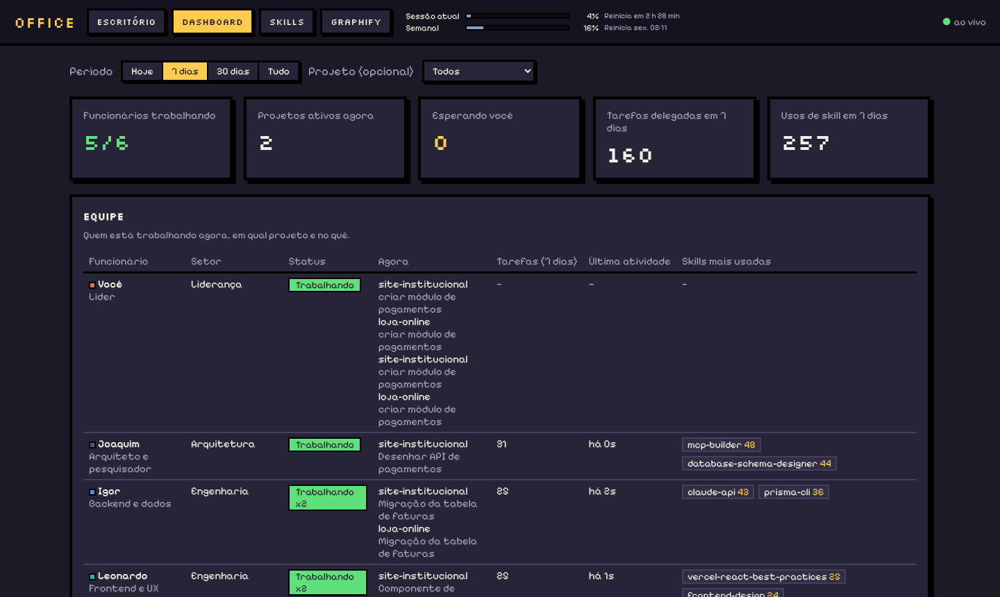

# IA Office

**Um escritório virtual em pixel art que mostra os seus agentes do Claude Code trabalhando, ao vivo.**

Cada sessão e cada subagente do [Claude Code](https://docs.claude.com/en/docs/claude-code/overview) vira uma pessoa no escritório. Quem recebe uma tarefa levanta, vai até a mesa e começa a trabalhar. O balão mostra a ferramenta que ela está usando, e linhas ligam quem passa trabalho para quem. Junto vêm um dashboard, um catálogo das suas skills, a integração com o [Graphify](https://github.com/Graphify-Labs/graphify) e uma equipe de 7 agentes pronta para usar com `claude --office`.

Tudo roda no seu computador: o servidor só aceita conexões da própria máquina e nenhum dado sai dela.



---

## Sumário

- [O que vem no IA Office](#o-que-vem-no-ia-office)
- [Requisitos](#requisitos)
- [Instalação passo a passo](#instalação-passo-a-passo)
- [O que a instalação muda no seu Claude Code](#o-que-a-instalação-muda-no-seu-claude-code)
- [Uso no dia a dia](#uso-no-dia-a-dia)
- [A equipe de agentes](#a-equipe-de-agentes)
- [Personalizar os agentes](#personalizar-os-agentes)
- [Como ler o escritório](#como-ler-o-escritório)
- [Dashboard, Skills e Graphify](#dashboard-skills-e-graphify)
- [Modo demonstração](#modo-demonstração)
- [Comandos](#comandos)
- [Problemas comuns](#problemas-comuns)
- [Desinstalar](#desinstalar)
- [Como funciona por dentro](#como-funciona-por-dentro)
- [Privacidade](#privacidade)
- [Licença](#licença)

---

## O que vem no IA Office

| | |
|---|---|
| **Escritório** | Andar em pixel art com salas, mesas, copa e área comum. Os agentes andam, sentam, mostram o que estão fazendo e voltam para a área comum quando terminam. |
| **Dashboard** | Quem está ativo, em qual projeto, quantas tarefas cada um fez, modelos usados (Opus, Sonnet, Haiku) e as skills e ferramentas mais usadas. |
| **Skills** | Lista todas as skills instaladas no seu Claude Code (pessoais, de plugins e de projetos), com busca, contagem de uso e o texto completo de cada uma. |
| **Graphify** | Gera o grafo de conhecimento do código dos seus projetos e permite fazer perguntas sobre ele, direto pelo navegador. |
| **Equipe de agentes** | Líder + 6 especialistas (arquitetura, backend, frontend, QA, segurança e code review) que trabalham juntos. Abre com `claude --office`. |
| **Uso do plano** | Barra no topo com o uso da sessão (limite de 5 horas) e da semana, com o horário de reinício (planos Pro e Max). |

---

## Requisitos

| Programa | Para quê | Obrigatório? |
|---|---|---|
| [Claude Code](https://docs.claude.com/en/docs/claude-code/setup) | É ele que o Office mostra | Sim |
| [Bun](https://bun.sh) 1.1 ou mais novo | Roda o servidor e os scripts | Sim |
| [Git](https://git-scm.com) | Baixar o projeto | Sim |
| [uv](https://docs.astral.sh/uv/) ou Python 3.10+ | Só para a aba Graphify | Não |

Funciona no **Windows**, **macOS** e **Linux**. Não precisa de `npm install`: o projeto não tem dependências externas.

### Instalar o que faltar

**Windows (PowerShell):**

```powershell
# Bun
powershell -c "irm bun.sh/install.ps1 | iex"
# Claude Code
irm https://claude.ai/install.ps1 | iex
# (opcional, para o Graphify) uv
powershell -ExecutionPolicy ByPass -c "irm https://astral.sh/uv/install.ps1 | iex"
```

**macOS / Linux:**

```bash
# Bun
curl -fsSL https://bun.sh/install | bash
# Claude Code
curl -fsSL https://claude.ai/install.sh | bash
# (opcional, para o Graphify) uv
curl -LsSf https://astral.sh/uv/install.sh | sh
```

Feche e abra o terminal depois de instalar e confira com `bun --version` e `claude --version`. Rode `claude` uma vez e faça login antes de continuar.

---

## Instalação passo a passo

### 1. Baixe o projeto

Escolha uma pasta fixa. O Claude Code vai apontar para ela; se você mudar a pasta de lugar depois, rode o `setup` de novo.

```bash
git clone https://github.com/andreluiscj/ia-office.git
cd ia-office
```

### 2. (Opcional) Diga o seu nome

Abra `company/empresa.json` e preencha `"usuario"` com o seu nome. É assim que os agentes vão te chamar e o nome que aparece na sala do Líder. Se deixar vazio, o Office usa o `user.name` do seu Git.

### 3. Rode o setup

```bash
bun run setup
```

Ele faz backup do seu `~/.claude/settings.json` antes de mexer e então:

1. instala os hooks que mandam os eventos do Claude Code para o Office;
2. instala a barra de status que envia o uso do plano (se você já tem uma barra, ela continua aparecendo);
3. instala os 7 agentes da equipe em `~/.claude/agents/`;
4. cria o comando `claude --office` no seu terminal (PowerShell, Bash e Zsh).

A seção [O que a instalação muda](#o-que-a-instalação-muda-no-seu-claude-code) detalha cada item.

### 4. Abra um terminal novo

O comando `claude --office` só existe em terminais abertos **depois** do setup. Feche também as sessões do Claude Code que estavam abertas.

**Só no Windows:** se aparecer um aviso de que a execução de scripts está desabilitada, rode uma vez no PowerShell:

```powershell
Set-ExecutionPolicy -Scope CurrentUser RemoteSigned
```

### 5. Ligue o Office

Escolha um jeito:

- **Automático:** o `claude --office` liga o servidor sozinho se ele estiver parado.
- **Junto com o Windows:** `bun run office:autostart`. O servidor passa a iniciar escondido quando você entra no Windows.
- **Manual (qualquer sistema):** `bun run office:ligar` (em segundo plano) ou `bun start` (neste terminal, mostrando o log).

Depois abra **http://localhost:7777**.

### 6. Teste

Num terminal, vá até a pasta de algum projeto seu e rode:

```bash
claude --office
```

Peça algo ao Líder e acompanhe no navegador. Se nada aparecer, rode `bun run check` na pasta do Office (veja [Problemas comuns](#problemas-comuns)).

### 7. (Opcional) Extras

```bash
bun run import             # traz o histórico das sessões antigas para o dashboard
bun run skills:install     # instala as skills recomendadas para a equipe
bun run graphify:instalar  # instala o Graphify (ou clique em "Instalar" na aba Graphify)
```

---

## O que a instalação muda no seu Claude Code

Tudo fica na pasta de configuração do Claude Code (`~/.claude`, ou a pasta de `CLAUDE_CONFIG_DIR` se você usa essa variável). Antes de cada alteração no `settings.json` é criado um backup `settings.json.bak-*` na mesma pasta.

| Onde | O que muda | Por quê |
|---|---|---|
| `settings.json` → `hooks` | Hooks em `SessionStart`, `SessionEnd`, `UserPromptSubmit`, `PreToolUse`, `PostToolUse`, `Notification`, `Stop`, `SubagentStart`, `SubagentStop` e `TeammateIdle` | Avisam o Office do que cada agente está fazendo. Os seus hooks continuam lá. |
| `settings.json` → `statusLine` | Barra de status do Office | Envia o uso do plano e o modelo. A sua barra anterior é guardada e continua aparecendo. |
| `settings.json` → `env` e `teammateMode` | `CLAUDE_CODE_EXPERIMENTAL_AGENT_TEAMS=1` e `teammateMode: "in-process"` | Liga as equipes de agentes do Claude Code (recurso experimental), usadas pelo Líder. |
| `settings.json` → `permissions` | `defaultMode: "acceptEdits"` e uma lista de comandos de leitura e teste liberados (`git status`, `git diff`, `npm test`, `bun test`, `pytest`...) | Menos pedidos de confirmação. Para manter as confirmações, use `bun scripts/install-company.ts install --com-confirmacoes`. |
| `settings.json` → `permissions.deny` | `git commit`, `git push`, `git merge`, `git rebase` e `git tag` bloqueados para o Claude | Só você faz commit e push. A equipe te entrega os comandos prontos. |
| `hooks/` | `escritorio-virtual-send.ts`, `escritorio-virtual-statusline.ts` e `escritorio-virtual-send-guarda-lider.ts` | Os scripts chamados pelos hooks. O "guarda" impede o Líder de editar arquivos: ele coordena, quem programa são os especialistas. |
| `agents/` | `empresa-lider.md` e mais 6 arquivos `empresa-*.md` | A equipe. |
| Perfil do terminal | Uma função `claude` entre as marcas `# >>> Office (claude --office) >>>` e `# <<< Office (claude --office) <<<` no perfil do PowerShell, no `~/.bashrc` e no `~/.zshrc` | Cria o `claude --office`. Sem `--office`, o `claude` funciona exatamente como antes. |

Fora do `~/.claude`, o Office só usa a pasta `~/.escritorio-virtual/` (banco SQLite e log).

**Atenção:** as permissões e o bloqueio de git valem para **todas** as sessões do Claude Code, não só as do Office. Já as sessões abertas só com `claude` (sem `--office`) não aparecem no escritório: os hooks continuam instalados, mas ignoram essas sessões.

---

## Uso no dia a dia

```bash
cd caminho/do/seu/projeto
claude --office                 # abre o Líder com a equipe e aparece no Office
claude --office --model opus    # escolhe o modelo do Líder
claude                          # Claude Code normal, sem equipe e sem Office
```

Exemplo de pedido: *"crie a tela de troca de senha com validação e testes"*.

1. O Líder lê o projeto e te mostra o plano: tarefas, quem faz cada uma, modelos, riscos e critérios de aceite.
2. Você aprova os planos grandes; os pequenos ele toca sozinho.
3. Ele distribui o trabalho. Os especialistas trabalham em paralelo (no máximo 5 ao mesmo tempo) e conversam entre si.
4. O QA testa, a Segurança audita quando precisa e o Code Review revisa por último.
5. Você recebe um resumo e os **comandos de commit prontos para colar** no terminal.

---

## A equipe de agentes

| Agente | Arquivo | O que faz | Modelo padrão |
|---|---|---|---|
| Líder (você) | `empresa-lider.md` | Entende o pedido, planeja, distribui, acompanha e entrega. Não programa. | O que você escolher |
| Joaquim | `empresa-arquiteto.md` | Arquitetura, pesquisa em documentação oficial, decisões registradas | Opus |
| Igor | `empresa-backend.md` | APIs, regras de negócio, banco local, testes unitários | Sonnet |
| Leonardo | `empresa-frontend.md` | Telas, componentes, acessibilidade, testes de componente | Sonnet |
| Luis Felipe | `empresa-qa.md` | Integração, E2E, regressão e aceite | Sonnet |
| Pedro | `empresa-seguranca.md` | Auditoria de segurança somente leitura (vulnerabilidades, segredos, LGPD) | Opus |
| Lucas | `empresa-revisor.md` | Code review final e comandos de commit | Sonnet |

Em tarefas de alto risco o Líder pode iniciar os especialistas com Opus. A arquitetura e as decisões ficam registradas em `.empresa/`, dentro do seu projeto.

---

## Personalizar os agentes

**Cada agente é um arquivo só**, em `company/agents/`. Nele estão o nome, o cargo, a aparência no escritório e todo o conhecimento (as instruções que o agente segue).

```markdown
---
# --- Como o agente aparece no Office (edite à vontade) ---
nome: "Joaquim"
cargo: "Arquiteto e pesquisador"
setor: produto
resumo: "Define a arquitetura antes do código..."
cor: "#3d5a80"
cabelo: "#7b7b8b"
pele: "#b07850"
# --- Configuração do Claude Code ---
name: empresa-arquiteto
description: "..."
model: opus
---
Você é o **{{arquiteto}}, Arquiteto e pesquisador** do Office...
```

1. Abra o arquivo e mude o que quiser: nome, cargo, cores, modelo ou o texto com as instruções (padrões do seu time, tecnologias preferidas, o que pode e o que não pode fazer).
2. Rode `bun run agentes:aplicar`, ou só abra `claude --office`, que aplica as mudanças sozinho.

Não mude o campo `name`: ele é o identificador do agente.

Nos textos dá para usar marcadores que viram o nome atual de cada um: `{{usuario}}`, `{{empresa}}`, `{{lider}}`, `{{arquiteto}}`, `{{backend}}`, `{{frontend}}`, `{{qa}}`, `{{seguranca}}` e `{{revisor}}`. Se você renomear o Arquiteto para "Marina", todos os outros agentes passam a chamá-la de Marina sem você editar mais nada.

`bun run agentes` mostra a equipe atual e onde está o arquivo de cada um. Mais detalhes em [company/README.md](company/README.md).

> Edite sempre os arquivos de `company/agents`. Os de `~/.claude/agents` são gerados a partir deles e são sobrescritos.

---

## Como ler o escritório

- **Salas no fundo:** Líder, Arquitetura, Segurança, Code Review e a sala de reunião.
- **Salão aberto:** a ilha de Engenharia e Testes, as mesas livres e a ilha dos terceirizados.
- **Copa e área comum:** onde a equipe fica quando não tem trabalho.
- **Recebeu uma tarefa:** a pessoa caminha até a mesa, senta e o monitor acende. O balão mostra a ferramenta em uso (Read, Edit, Bash...).
- **Linha branca:** tarefa entregue pelo Líder. **Linha dourada com envelope:** um agente passando informação para outro.
- **Terceirizados:** subagentes que não são da equipe (como o `Explore`) chegam pelo elevador e vão embora ao terminar.
- **"!" amarelo no Líder:** o Claude está esperando sua resposta ou permissão.

Arraste para mover, use a roda do mouse para zoom e ⤢ para ver o andar inteiro. Passe o mouse sobre alguém para ver o que está fazendo; clique para ver cargo, tarefa atual, modelo e skills mais usadas.

---

## Dashboard, Skills e Graphify



- **Dashboard** (`/dashboard`): agentes ativos, projetos, tarefas por funcionário, divisão de modelos e ranking de skills e ferramentas. Toda sessão principal conta como o Líder; cada subagente conta para o funcionário correspondente.
- **Skills** (`/skills`): todas as skills de `~/.claude/skills`, `~/.agents/skills`, dos plugins (`~/.claude/plugins`), os comandos (`~/.claude/commands`) e as pastas `.claude/` dos projetos onde o Claude Code já rodou. Conta como uso cada chamada da ferramenta `Skill` e cada comando com barra digitado (comandos internos como `/model` não contam).
- **Graphify** (`/graphify`): roda o [Graphify](https://github.com/Graphify-Labs/graphify) nos seus projetos.
  - Os projetos onde o Claude Code já trabalhou aparecem sozinhos; dá para adicionar outras pastas e **ocultar** as que não interessam.
  - **Gerar grafo** roda `graphify update` e cria `graphify-out/` dentro do projeto (grafo interativo, relatório e `graph.json`).
  - **Perguntar** usa os comandos do Graphify (`query`, `explain`, `path`, `affected`, `god-nodes`).
  - **Ativar /graphify no Claude Code** instala a skill do Graphify em `~/.claude/skills/graphify` e adiciona uma seção ao seu `~/.claude/CLAUDE.md`, para os agentes também usarem o grafo.
  - Dica: coloque `graphify-out/` no `.gitignore` dos seus projetos.

---

## Modo demonstração

Para ver o Office funcionando sem usar o Claude Code. Usa um banco separado, com dados inventados. Em dois terminais:

```bash
bun run demo:server
bun run demo
```

Abra http://localhost:7777. Para voltar aos dados reais, pare os dois e rode `bun start`.

---

## Comandos

| Comando | O que faz |
|---|---|
| `bun run setup` | Instala tudo (hooks, equipe e `claude --office`) |
| `bun start` | Liga o servidor neste terminal |
| `bun run office:ligar` / `office:parar` / `office:status` | Liga em segundo plano, para ou mostra o estado |
| `bun run office:autostart` / `office:autostart:remover` | Inicia ou não junto com o Windows |
| `bun run agentes` | Mostra a equipe e o arquivo de cada agente |
| `bun run agentes:aplicar` | Aplica as edições dos agentes no Claude Code |
| `bun run check` | Diagnóstico: hooks, servidor e último evento recebido |
| `bun run import` | Importa o histórico de `~/.claude/projects` |
| `bun run skills:install` | Instala as skills recomendadas (`skills:install:opcionais` inclui Prisma, Claude API e afins) |
| `bun run graphify:instalar` | Instala o Graphify com o uv |
| `bun run hooks:install` / `hooks:uninstall` | Só os hooks e a barra de status |
| `bun run empresa:install` / `empresa:uninstall` | Só a equipe, as permissões e o bloqueio de git |
| `bun run office:comando` / `office:comando:remover` | Só o comando `claude --office` |
| `bun run desinstalar` | Remove tudo o que o setup instalou |

---

## Problemas comuns

**Ninguém aparece no escritório**
1. Rode `bun run check` na pasta do Office. Ele mostra se os hooks estão instalados, se o servidor está no ar e quando chegou o último evento.
2. Confira se abriu a sessão com `claude --office` (só `claude` não aparece) e se ela foi aberta depois do setup.
3. Confira se o servidor está ligado com `bun run office:status`.

**`claude --office` dá "unknown option"**
O terminal não carregou a função. Abra um terminal novo. No Windows, confira `Get-ExecutionPolicy` (precisa ser `RemoteSigned`) e rode `bun run office:comando` de novo.

**A barra de uso está vazia**
Ela só aparece depois da primeira resposta do Claude e só em planos Pro e Max.

**Quero outra porta**
Windows: `$env:PORT=8080; bun run hooks:install; bun start`. macOS/Linux: `PORT=8080 bun run hooks:install && PORT=8080 bun start`.

**Mudei a pasta do Office de lugar**
Rode `bun run setup` de novo na pasta nova.

**Atualizei o código e o Office não mudou**
Rode `bun run office:parar` e depois `bun run office:ligar`.

**Log do servidor:** `~/.escritorio-virtual/servidor.log`.

---

## Desinstalar

```bash
bun run desinstalar               # hooks, barra de status, equipe, permissões e o claude --office
bun run office:autostart:remover  # só se usou o autostart no Windows
bun run office:parar
```

Depois, se quiser, apague a pasta do projeto e `~/.escritorio-virtual/` (banco e log). A skill do Graphify, se você ativou, fica em `~/.claude/skills/graphify`.

---

## Como funciona por dentro

```
Claude Code ──hooks──▶ hooks/send.ts ──HTTP──▶ servidor (Bun) ──▶ SQLite
                                                    │
~/.claude/projects/*.jsonl ──bun run import──▶──────┘
                                                    │ WebSocket
                                                    ▼
                                 Escritório (canvas) · Dashboard · Skills · Graphify
```

- O `claude --office` define `CLAUDE_OFFICE=1`, atualiza os agentes, liga o servidor se precisar e abre `claude --agent empresa-lider`.
- `hooks/send.ts` recebe o JSON de cada evento e envia para `http://127.0.0.1:7777/events`. Se a sessão não for do Office ou se o servidor estiver desligado, ele sai em milissegundos sem atrapalhar o Claude.
- O servidor guarda tudo em `~/.escritorio-virtual/escritorio.db` e avisa as telas pelo WebSocket.

```
server/index.ts        servidor HTTP + WebSocket + APIs
server/db.ts           banco SQLite e regras de cada evento
server/company.ts      visão de empresa (Líder, funcionários, terceirizados)
server/agentes.ts      lê company/ e gera os agentes do Claude Code
server/skills.ts       lista as skills instaladas
server/graphify.ts     integração com o Graphify
hooks/                 hook de eventos, barra de status e guarda do Líder
scripts/               setup, diagnóstico, demonstração, autostart e utilitários
company/empresa.json   nome da empresa, seu nome e setores
company/agents/        um arquivo por agente
public/                telas (escritório, dashboard, skills, graphify)
```

### Limitações

- Só aparecem agentes que rodam no seu computador. Sessões do Claude Code na nuvem não deixam rastro local.
- As equipes de agentes do Claude Code são um recurso experimental e podem mudar.
- Iniciar junto com o sistema só existe no Windows por enquanto.

---

## Privacidade

- O servidor escuta só em `127.0.0.1` e não aceita conexões de outras máquinas.
- Os eventos, o banco e os grafos ficam no seu computador. O Office não usa serviço externo nem telemetria.

---

## Licença

[MIT](LICENSE). O Graphify é da [Graphify Labs](https://github.com/Graphify-Labs/graphify) (Apache-2.0) e o `vis-network` incluído em `public/vendor` é Apache-2.0 ou MIT.
