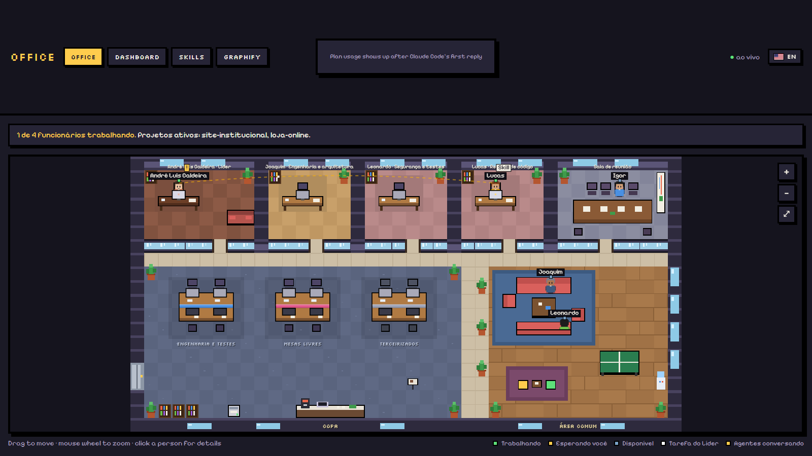
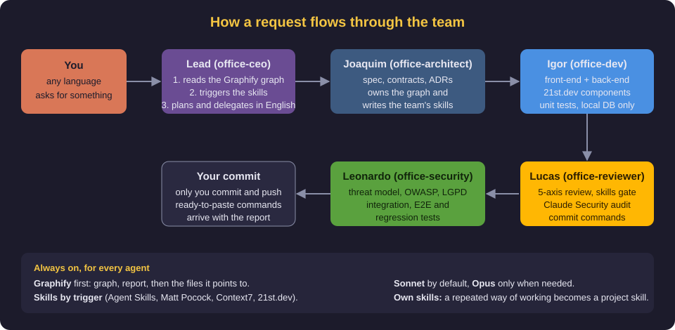
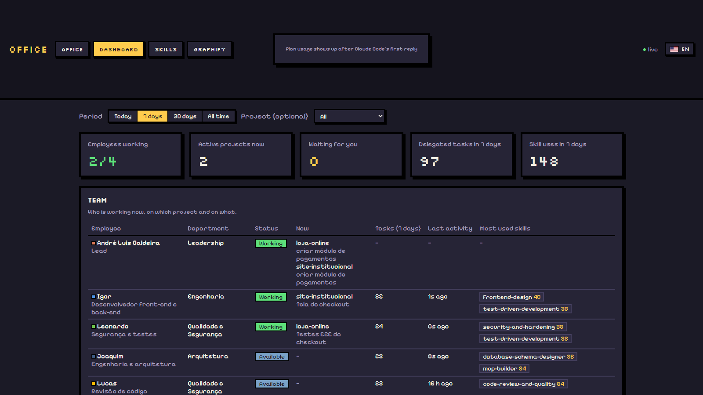
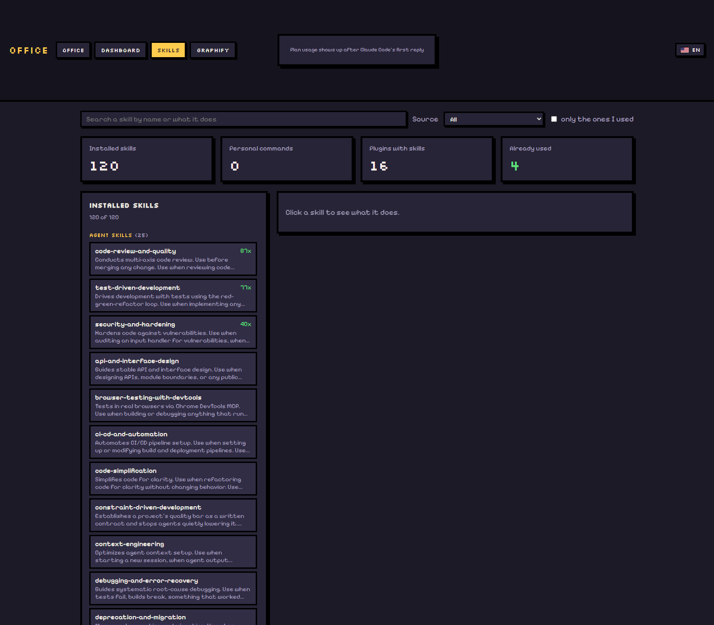
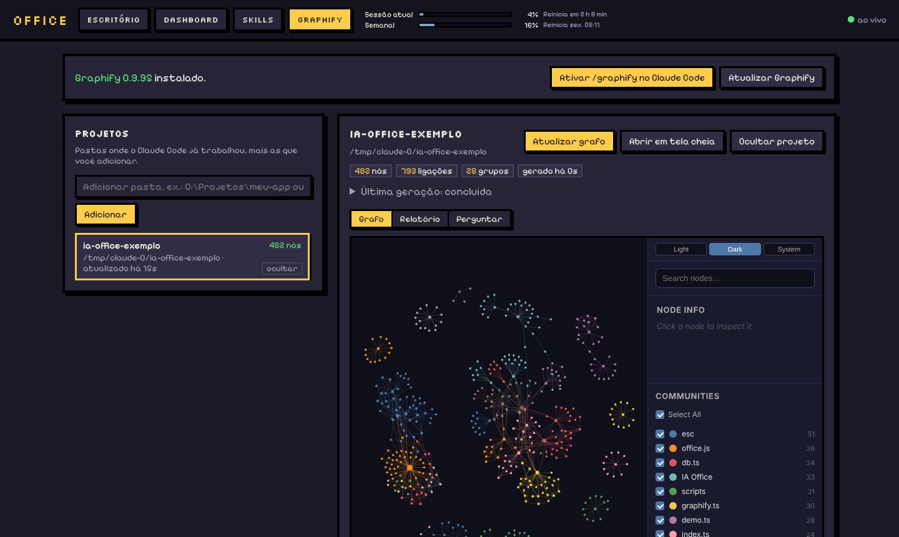

# IA Office

**A pixel-art virtual office that shows your Claude Code agents at work, live, with a five-agent team that uses skills on its own.**

Every [Claude Code](https://docs.claude.com/en/docs/claude-code/overview) session and subagent becomes a person in the office. Whoever gets a task stands up, walks to a desk and starts working. A speech bubble shows the tool they are using, and lines connect whoever hands work to whom. It also ships a dashboard, a catalog of your skills, a [Graphify](https://github.com/Graphify-Labs/graphify) integration and a ready-to-use team: a Lead plus an architect, a developer, a security and testing engineer and a reviewer, opened with `claude --office`.

Everything runs on your machine: the server only accepts local connections and no data leaves it.



---

## Contents

- [What's in IA Office](#whats-in-ia-office)
- [Requirements](#requirements)
- [Step-by-step install](#step-by-step-install)
- [Install the skill stack](#install-the-skill-stack)
- [What the install changes in Claude Code](#what-the-install-changes-in-claude-code)
- [Daily use](#daily-use)
- [The agent team](#the-agent-team)
- [How the team works](#how-the-team-works)
- [Benchmarks](#benchmarks)
- [Customizing the agents](#customizing-the-agents)
- [Reading the office](#reading-the-office)
- [Dashboard, Skills and Graphify](#dashboard-skills-and-graphify)
- [Demo mode](#demo-mode)
- [Commands](#commands)
- [Troubleshooting](#troubleshooting)
- [Uninstall](#uninstall)
- [How it works](#how-it-works)
- [Privacy](#privacy)
- [License](#license)

---

## What's in IA Office

| | |
|---|---|
| **Office** | Pixel-art floor with rooms, desks, kitchen and lounge. Agents walk, sit, show what they are doing and go back to the lounge when done. |
| **Agent team** | A Lead and four specialists: architecture and engineering, full-stack development, security and testing, and code review. Opens with `claude --office`. |
| **Automatic skills** | Every agent has a table of triggers ("a library is involved", "a screen is needed", "a bug shows up") mapped to installed skills, and calls them before doing anything else. A hook blocks an agent that finishes without calling a skill. |
| **Graphify first** | Agents read the project's knowledge graph before opening code, so they understand how a project works quickly and with few tokens. |
| **Skills that learn you** | When you ask for the same thing the same way twice, the team writes a project skill so the next one is faster and closer to how you work. |
| **Claude Security audit** | At the end of a project, an audit or attack-attempt request runs the whole [Claude Security](https://code.claude.com/docs/en/claude-security) plugin. |
| **Dashboard** | Who is active, on which project, how many tasks each one did, models used (Opus, Sonnet, Haiku) and the most used skills and tools. |
| **Skills** | Lists the skills installed in your Claude Code, grouped by plugin or theme, with search, usage count and the full text of each one. |
| **Graphify tab** | Builds the knowledge graph of your projects' code and lets you ask questions about it, right from the browser. |
| **9 languages** | Flag picker at the top right: English by default, plus Portuguese, Spanish, Italian, German, French, Chinese, Japanese and Hindi. |
| **Plan usage** | A top bar with session usage (5-hour limit) and weekly usage, with reset time (Pro and Max plans). |

---

## Requirements

| Program | What for | Required? |
|---|---|---|
| [Claude Code](https://docs.claude.com/en/docs/claude-code/setup) | It is what the Office shows | Yes |
| [Bun](https://bun.sh) 1.1 or newer | Runs the server and scripts | Yes |
| [Git](https://git-scm.com) | Download the project | Yes |
| [Node.js](https://nodejs.org) (for `npx`) | Runs the Context7 MCP server | For the skill stack |
| Python 3.9+ available as `python3` | Needed by the Claude Security plugin | For the audit |
| [uv](https://docs.astral.sh/uv/) or Python 3.10+ | Only for the Graphify tab | No |

Works on **Windows**, **macOS** and **Linux**. No `npm install` needed: the project itself has no external dependencies.

### Install what is missing

**Windows (PowerShell):**

```powershell
# Bun
powershell -c "irm bun.sh/install.ps1 | iex"
# Claude Code
irm https://claude.ai/install.ps1 | iex
# (optional, for Graphify) uv
powershell -ExecutionPolicy ByPass -c "irm https://astral.sh/uv/install.ps1 | iex"
```

**macOS / Linux:**

```bash
# Bun
curl -fsSL https://bun.sh/install | bash
# Claude Code
curl -fsSL https://claude.ai/install.sh | bash
# (optional, for Graphify) uv
curl -LsSf https://astral.sh/uv/install.sh | sh
```

Close and reopen the terminal after installing and check with `bun --version` and `claude --version`. Run `claude` once and log in before continuing.

---

## Step-by-step install

### 1. Download the project

Pick a fixed folder. Claude Code will point to it; if you move the folder later, run `setup` again.

```bash
git clone https://github.com/andreluiscj/ia-office.git
cd ia-office
```

### 2. (Optional) Tell it your name

Open `company/empresa.json` and fill `"usuario"` with your name. That is how the agents will call you and the name shown in the Lead's room. If left empty, the Office uses your Git `user.name`.

### 3. Run setup

```bash
bun run setup
```

It backs up your `~/.claude/settings.json` before touching it, then:

1. installs the hooks that send Claude Code events to the Office and the one that stops agents from finishing without a skill;
2. installs the status line that reports plan usage (if you already have one, it keeps showing);
3. installs the five team agents in `~/.claude/agents/`;
4. creates the `claude --office` command in your terminal (PowerShell, Bash and Zsh).

The section [What the install changes](#what-the-install-changes-in-claude-code) details each item.

### 4. Open a new terminal

`claude --office` only exists in terminals opened **after** setup. Also close any Claude Code sessions that were open.

**Windows only:** if you see a warning that running scripts is disabled, run once in PowerShell:

```powershell
Set-ExecutionPolicy -Scope CurrentUser RemoteSigned
```

### 5. Install the skill stack

The team is built to use a specific set of skills, plugins and MCP servers. See [Install the skill stack](#install-the-skill-stack) below. Without it the agents still work, but they will report `NO SKILL` for most triggers.

### 6. Start the Office

Pick one:

- **Automatic:** `claude --office` starts the server by itself if it is not running.
- **With Windows:** `bun run office:autostart`. The server starts hidden when you log in to Windows.
- **Manual (any OS):** `bun run office:ligar` (background) or `bun start` (this terminal, showing the log).

Then open **http://localhost:7777**.

### 7. Try it

In a terminal, go to one of your projects and run:

```bash
claude --office
```

Ask the Lead for something, in any language, and watch it in the browser. If nothing shows up, run `bun run check` in the Office folder (see [Troubleshooting](#troubleshooting)).

### 8. (Optional) Extras

```bash
bun run import             # imports old session history into the dashboard
bun run graphify:instalar  # installs Graphify (or click "Install" in the Graphify tab)
```

---

## Install the skill stack

The team relies on these pieces. Run the commands once, in any terminal:

| Piece | What it gives the team | Install |
|---|---|---|
| [Agent Skills](https://github.com/addyosmani/agent-skills) | The software lifecycle as skills: spec, plan, build, test, review, simplify, ship | `claude plugin marketplace add https://github.com/addyosmani/agent-skills.git` then `claude plugin install agent-skills@addy-agent-skills` |
| [Matt Pocock Skills](https://github.com/mattpocock/skills) | Engineering and architecture skills: grilling, domain modelling, deep modules, TDD, diagnosis | `claude plugin install mattpocock-skills@claude-plugins-official` |
| `skill-creator` | Lets the team write skills that adapt to how you work | `claude plugin install skill-creator@claude-plugins-official` |
| `frontend-design` | Distinctive visual design for screens and sites | `claude plugin install frontend-design@anthropic-plugin-directory` |
| [Claude Security](https://code.claude.com/docs/en/claude-security) | Multi-agent vulnerability scan of a repository or a diff, with verified findings and patches | `claude plugin install claude-security@claude-plugins-official` (needs `python3`) |
| [Context7](https://github.com/upstash/context7) | Current documentation of any library or framework | `claude mcp add --scope user context7 -- npx -y @upstash/context7-mcp` |
| [21st.dev MCP](https://21st.dev/mcp) | Thousands of ready UI components for front-end work | create a key at 21st.dev/mcp, set it as `API_KEY_21ST`, then `claude mcp add --transport http --scope user 21st https://21st.dev/api/mcp --header 'x-api-key: ${API_KEY_21ST}'` |
| [Graphify](https://github.com/Graphify-Labs/graphify) | The project graph agents must read first | `bun run graphify:instalar` or the **Install** button in the Graphify tab |

Set the 21st.dev key as an environment variable, never in a file you commit. On Windows: `setx API_KEY_21ST "your-key"`; on macOS/Linux add `export API_KEY_21ST="your-key"` to your shell profile. Then open a new terminal.

Check with `claude plugin list` and `claude mcp list`. Plugin skills only appear in sessions started after the install.

---

## What the install changes in Claude Code

Everything stays in Claude Code's config folder (`~/.claude`, or the `CLAUDE_CONFIG_DIR` folder if you use that variable). Before each change to `settings.json`, a `settings.json.bak-*` backup is created in the same folder.

| Where | What changes | Why |
|---|---|---|
| `settings.json` → `hooks` | Hooks on `SessionStart`, `SessionEnd`, `UserPromptSubmit`, `PreToolUse`, `PostToolUse`, `Notification`, `Stop`, `SubagentStart`, `SubagentStop` and `TeammateIdle` | Tell the Office what each agent is doing. Your own hooks stay. |
| `settings.json` → `statusLine` | Office status line | Reports plan usage and model. Your previous status line is kept and still shows. |
| `settings.json` → `env` and `teammateMode` | `CLAUDE_CODE_EXPERIMENTAL_AGENT_TEAMS=1` and `teammateMode: "in-process"` | Enables Claude Code agent teams (experimental), used by the Lead. |
| `settings.json` → `permissions` | `defaultMode: "acceptEdits"` and an allowlist of read and test commands (`git status`, `git diff`, `npm test`, `bun test`, `pytest`...) | Fewer confirmation prompts. To keep confirmations, use `bun scripts/install-company.ts install --com-confirmacoes`. |
| `settings.json` → `permissions.deny` | `git commit`, `git push`, `git merge`, `git rebase` and `git tag` blocked for Claude | Only you commit and push. The team hands you ready commands. |
| `hooks/` | `escritorio-virtual-send.ts`, `escritorio-virtual-statusline.ts`, `escritorio-virtual-send-guarda-lider.ts` and `escritorio-virtual-send-exigir-skill.ts` | Scripts called by the hooks. The "guard" stops the Lead from editing files (except its own memory): it coordinates, the specialists code. The skill gate blocks an `office-*` agent that tries to finish without calling a skill. |
| `agents/` | `office-ceo.md`, `office-architect.md`, `office-dev.md`, `office-security.md` and `office-reviewer.md` | The team. Old `empresa-*` and `office-*` agent files that no longer exist in `company/agents` are removed. |
| Terminal profile | A `claude` function between the `# >>> Office (claude --office) >>>` and `# <<< Office (claude --office) <<<` markers in the PowerShell profile, `~/.bashrc` and `~/.zshrc` | Creates `claude --office`. Without `--office`, `claude` works exactly as before. |

Outside `~/.claude`, the Office only uses `~/.escritorio-virtual/` (SQLite database and log).

**Note:** the permissions and the git block apply to **all** Claude Code sessions, not just the Office's. Sessions opened with plain `claude` (no `--office`) do not show in the office: the hooks stay installed but ignore those sessions.

---

## Daily use

```bash
cd path/to/your/project
claude --office                 # opens the Lead with the team and shows up in the Office
claude --office --model opus    # picks the Lead's model
claude                          # plain Claude Code, no team and no Office
```

Example request: *"build the change-password screen with validation and tests"*.

1. The Lead reads the project graph, triggers the matching skills and shows you the plan: tasks, who does each one, models, risks and acceptance criteria.
2. You approve large plans; small ones it runs on its own.
3. It assigns the work. Specialists work in parallel (at most 4 at once) and talk to each other.
4. Review is proportional to risk: the Reviewer always, Security and Testing when there is a user flow, integration, login, data, permissions, dependencies or secrets.
5. You get a summary and **ready-to-paste commit commands**.

**Language:** write to the Lead in any language. It restates your request in English for the team, because agents work better with each other in English, and answers you back in your own language.

---

## The agent team

| Agent | Id | What it does | Default model |
|---|---|---|---|
| Lead (you) | `office-ceo` | Understands the request, reads the graph, triggers skills, plans, delegates, validates and delivers. Never edits files. | Your choice |
| Joaquim | `office-architect` | Engineering and architecture: specs, contracts, ADRs, owner of the Graphify graph, writer of the team's skills. | Sonnet |
| Igor | `office-dev` | Full-stack: APIs, business rules, local-database migrations, screens, components and unit tests, with 21st.dev components for visual work. | Sonnet |
| Leonardo | `office-security` | Security audit (read-only) and integration, E2E and regression tests. Routes every finding to its owner and confirms the fix. | Sonnet |
| Lucas | `office-reviewer` | Last gate before your commit: five-axis review, skills gate, commit commands and the end-of-project Claude Security audit. | Sonnet |



Architecture and decisions are recorded in `.empresa/` inside your project (`plano.md`, `arquitetura.md`, `adr/`, `licoes.md`, `padroes.md`).

---

## How the team works

Every agent is built around four goals: **efficiency, effectiveness, skill use and token economy**.

### Skills by trigger

Skills are the project's main difference. Each agent has a table of triggers and, **before any other tool**, calls the `Skill` tool for the ones that apply. A few examples from the Lead's table:

| Trigger | Skill |
|---|---|
| Vague request, missing who or why | `interview-me` / `grilling` |
| New system or large change without a spec | `spec-driven-development` |
| A library, framework, SDK or CLI is involved | Context7 + `source-driven-development` |
| A screen, site or visual system | `frontend-design` + 21st.dev MCP + `frontend-ui-engineering` |
| Executing a code task | `incremental-implementation` + `tdd` |
| A bug or failing test | `debugging-and-error-recovery` / `diagnosing-bugs` |
| Login, personal data, upload, public API, new dependency | `security-and-hardening` |
| Reviewing a change | `code-review-and-quality` / `code-review` |
| Before handing over | `shipping-and-launch` and `pr` |
| End-of-project audit or attack attempt | Claude Security, mandatory |

If no skill fits a step, the agent writes `NO SKILL: <step>` in its report. Reports end with `SKILLS INVOKED`, and the Lead and the Reviewer compare that line with the calls the Skills panel recorded. A missing line sends the work back to its author, and a hook blocks the agent from finishing without any skill call.

### Graphify first

Agents never start by reading files. They query the graph in a fixed order, at most three queries before deciding:

1. `graph_stats`, to confirm a graph exists and how current it is;
2. the beginning of `graphify-out/GRAPH_REPORT.md`, the project map in a few lines;
3. one precise question: where is X (`graphify_find`), how does X work (`query_graph`), who uses X (`graphify_callers`), what breaks if I change X (`graphify_impact`), which tests cover X (`graphify_tests_for`);
4. only then the files the graph pointed to, reading excerpts.

The Lead hands each specialist a map of one to three lines (module, files, dependents) instead of pasted code. Joaquim generates and refreshes the graph.

### Skills that learn how you work

The Lead notices patterns: a procedure repeated twice, a correction you keep making, a delivery format you always ask for. It logs them in `.empresa/padroes.md`, and on the second occurrence Joaquim writes a short project skill in `.claude/skills/<task>/` with `skill-creator`, reviewed by the Reviewer. Skills stay inside the project, never in your global folder, and you are told about each new one.

### Models

Sonnet is the default for everyone. Opus is the exception, used only when Sonnet cannot deliver good quality: animated sites and visually ambitious screens, or very large project structures, and after Sonnet fails twice on the same problem. The Lead records `MODEL: opus — reason` in the plan and goes back to Sonnet as soon as the hard part is done.

### Review and audit

- Nothing is done because its author says so: a peer, Leonardo's tests and the Reviewer's verdict stand between a change and your commit.
- **End-of-project audit:** when you ask for an audit or an attack attempt, Lucas must use the whole Claude Security plugin: scan the codebase, scan the changes and suggest patches, repeating scans until no critical or high finding remains. The plugin runs only in the main session, so the Lead runs `/claude-security` when Lucas asks, and Lucas triages the report. Claude Security reads and reasons about code like a security researcher; it does not attack a running instance. For dynamic tests against a running app, Leonardo writes them.
- **Commits are yours:** no agent commits, pushes, merges or deploys. You get ready-to-paste commands, one block per logical change.

### Memory and economy

- **Memory:** each agent has its own memory (`memory: project`, in `.claude/agent-memory/<agent>/`) and reads the shared project memory (`CLAUDE.md` and `.empresa/`, including `licoes.md` with mistakes found in review and tests).
- **Tokens:** minimal reading, bounded command output, no narration, reports of about 25 lines with `path:line` instead of pasted files.

---

## Benchmarks

- [docs/benchmarks.md](docs/benchmarks.md): small tasks (a question, a bug fix, a small feature), plain Claude Code against the Office team.
- [docs/benchmarks-saas.md](docs/benchmarks-saas.md): one large task, building a multi-tenant SaaS from scratch, with independent security tests, real-browser UI checks and side-by-side screenshots.

These runs were made with the previous seven-agent team and skill set; they have not been repeated for the current one.

---

## Customizing the agents

**Each agent is a single file** in `company/agents/`. It holds the name, role, look in the office and all the knowledge (the instructions the agent follows).

```markdown
---
# --- How the agent shows up in the Office (edit freely) ---
nome: "Joaquim"
cargo: "Engenharia e arquitetura"
setor: produto
resumo: "Reads the graph, defines the architecture before any code..."
cor: "#3d5a80"
cabelo: "#7b7b8b"
pele: "#b07850"
# --- Claude Code configuration ---
name: office-architect
description: "..."
model: sonnet
memory: project
---
## 0. Language and role
All communication with the team is in English. You answer to the Lead ({{lider}})...
```

1. Open the file and change whatever you want: name, role, colors, model or the instruction text (your team's standards, preferred tech, what it may and may not do).
2. Run `bun run agentes:aplicar`, or just open `claude --office`, which applies the changes by itself.

Do not change the `name` field: it is the agent's id. The Office keys (`nome`, `cargo`, `setor`, `resumo`, `cor`, `cabelo`, `pele`) keep their names. Keep the agent files in English: the team talks to each other in English.

In the text you can use placeholders that become each one's current name: `{{usuario}}`, `{{empresa}}`, `{{lider}}`, `{{arquiteto}}`, `{{dev}}`, `{{seguranca}}` and `{{revisor}}`. If you rename the architect to "Marina", every other agent calls her Marina without further edits.

`bun run agentes` shows the current team and where each file is. More in [company/README.md](company/README.md).

> Always edit the files in `company/agents`. The ones in `~/.claude/agents` are generated from them and get overwritten. Applying also removes old `empresa-*` and `office-*` files that no longer exist there.

---

## Reading the office

- **Back rooms:** Lead, Architecture, Security and Testing, Code Review and the meeting room.
- **Open floor:** the Engineering island, free desks and the contractors' island.
- **Kitchen and lounge:** where the team stays when there is no work.
- **Got a task:** the person walks to the desk, sits and the monitor turns on. The bubble shows the tool in use (Read, Edit, Bash...).
- **White line:** a task handed out by the Lead. **Gold line with an envelope:** one agent passing information to another.
- **Contractors:** subagents that are not on the team (like `Explore`) arrive by elevator and leave when done.
- **Yellow "!" on the Lead:** Claude is waiting for your answer or permission.

Drag to move, use the mouse wheel to zoom and ⤢ to see the whole floor. Hover over someone to see what they are doing; click to see role, current task, model and most used skills.

---

## Dashboard, Skills and Graphify

### Dashboard (`/dashboard`)

Active agents, projects, tasks per employee, model split and ranking of skills and tools. Every main session counts as the Lead; each subagent counts for the matching employee.



### Skills (`/skills`)

The skills that Claude Code actually has: `~/.claude/skills`, the plugins that are installed and enabled, commands (`~/.claude/commands`) and the `.claude/` folders of projects where Claude Code has run. Marketplace clones and old plugin versions are not counted.

The list is grouped by category: **one group per plugin that has several skills** (for example *Agent Skills* or *Engineering*, where Matt Pocock's skills are merged), and **themes** (Design, Security, Documents, Tools) for skills that come alone. A skill that two plugins both provide is shown once. Search, filter by category and open the full instructions of each one. Each `Skill` tool call and each typed slash command counts as a use (built-ins like `/model` do not).



### Graphify (`/graphify`)

Runs [Graphify](https://github.com/Graphify-Labs/graphify) on your projects.

- Projects where Claude Code has worked show up automatically; you can add other folders and **hide** the ones you do not care about.
- **Build graph** runs `graphify update` and creates `graphify-out/` in the project (interactive graph, report and `graph.json`).
- **Ask** uses Graphify commands (`query`, `explain`, `path`, `affected`, `god-nodes`).
- **Enable /graphify in Claude Code** installs the Graphify skill in `~/.claude/skills/graphify` and adds a section to your `~/.claude/CLAUDE.md`, so the agents use the graph too.
- Tip: add `graphify-out/` to your projects' `.gitignore`.



---

## Demo mode

See the Office working without Claude Code. It uses a separate database with made-up data. In two terminals:

```bash
bun run demo:server
bun run demo
```

Open http://localhost:7777. To go back to real data, stop both and run `bun start`.

---

## Commands

| Command | What it does |
|---|---|
| `bun run setup` | Installs everything (hooks, team and `claude --office`) |
| `bun start` | Starts the server in this terminal |
| `bun run office:ligar` / `office:parar` / `office:status` | Start in background, stop or show status |
| `bun run office:autostart` / `office:autostart:remover` | Start with Windows or not |
| `bun run agentes` | Shows the team and each agent's file |
| `bun run agentes:aplicar` | Applies agent edits to Claude Code |
| `bun run bench` / `bench:report` | Runs the benchmark (plain Claude Code vs the Office team) and regenerates [docs/benchmarks.md](docs/benchmarks.md) |
| `bun run check` | Diagnostics: hooks, server and last event received |
| `bun run import` | Imports history from `~/.claude/projects` |
| `bun run graphify:instalar` | Installs Graphify with uv |
| `bun run hooks:install` / `hooks:uninstall` | Only the hooks and status line |
| `bun run empresa:install` / `empresa:uninstall` | Only the team, permissions and git block |
| `bun run office:comando` / `office:comando:remover` | Only the `claude --office` command |
| `bun run desinstalar` | Removes everything setup installed |

The old `skills:install` script is disabled on purpose: skills now come from the plugins listed in [Install the skill stack](#install-the-skill-stack).

---

## Troubleshooting

**Nobody shows up in the office**
1. Run `bun run check` in the Office folder. It shows whether hooks are installed, the server is up and when the last event arrived.
2. Check you opened the session with `claude --office` (plain `claude` does not show) and after setup.
3. Check the server is on with `bun run office:status`.

**`claude --office` says "unknown option"**
The terminal did not load the function. Open a new terminal. On Windows, check `Get-ExecutionPolicy` (must be `RemoteSigned`) and run `bun run office:comando` again.

**The agents still have the old names or instructions**
Run `bun run agentes:aplicar` and open a new session. Claude Code reads agents when a session starts.

**Agents report `NO SKILL` for almost everything**
The skill stack is missing or was installed after the session began. Run `claude plugin list` and `claude mcp list`, install what is missing and open a new session.

**The 21st.dev MCP shows "needs authentication"**
`API_KEY_21ST` is not set in that terminal. Set it, open a new terminal and run `claude mcp list` again. A `503` means the 21st.dev service itself is unavailable; try again later.

**`/claude-security` warns about Python**
The plugin needs `python3` 3.9 or newer on your `PATH`. On Windows the Microsoft Store shortcut is not enough: install Python and make sure `python3 --version` works.

**The Skills tab shows hundreds of skills**
Update to the current version. It now counts only installed and enabled plugins; older versions also counted marketplace clones.

**The usage bar is empty**
It only shows after Claude's first reply and only on Pro and Max plans.

**I want another port**
Windows: `$env:PORT=8080; bun run hooks:install; bun start`. macOS/Linux: `PORT=8080 bun run hooks:install && PORT=8080 bun start`.

**I moved the Office folder**
Run `bun run setup` again in the new folder.

**I updated the code and the Office did not change**
Run `bun run office:parar` then `bun run office:ligar`.

**Server log:** `~/.escritorio-virtual/servidor.log`.

---

## Uninstall

```bash
bun run desinstalar               # hooks, status line, team, permissions and claude --office
bun run office:autostart:remover  # only if you used autostart on Windows
bun run office:parar
```

Then, if you want, delete the project folder and `~/.escritorio-virtual/` (database and log). The skill stack is separate: remove plugins with `claude plugin uninstall <name>` and MCP servers with `claude mcp remove <name>`. The Graphify skill, if you enabled it, lives in `~/.claude/skills/graphify`.

---

## How it works

```
Claude Code ──hooks──▶ hooks/send.ts ──HTTP──▶ server (Bun) ──▶ SQLite
                                                    │
~/.claude/projects/*.jsonl ──bun run import──▶──────┘
                                                    │ WebSocket
                                                    ▼
                                 Office (canvas) · Dashboard · Skills · Graphify
```

- `claude --office` sets `CLAUDE_OFFICE=1`, updates the agents, starts the server if needed and opens `claude --agent office-ceo`.
- `hooks/send.ts` receives each event's JSON and sends it to `http://127.0.0.1:7777/events`. If the session is not an Office one or the server is off, it exits in milliseconds without getting in Claude's way.
- `hooks/exigir-skill.ts` runs when an `office-*` agent tries to stop and blocks it if the transcript has no `Skill` call.
- The server stores everything in `~/.escritorio-virtual/escritorio.db` and notifies the screens over WebSocket.

```
server/index.ts        HTTP + WebSocket server + APIs
server/db.ts           SQLite database and per-event rules
server/company.ts      company view (Lead, employees, contractors)
server/agentes.ts      reads company/ and generates the Claude Code agents
server/skills.ts       lists installed skills and plugins
server/graphify.ts     Graphify integration
hooks/                 event hook, status line, Lead guard and skill gate
scripts/               setup, diagnostics, demo, autostart and utilities
company/empresa.json   company name, your name and departments
company/agents/        one file per agent
public/                screens (office, dashboard, skills, graphify)
docs/                  screenshots, team diagram and benchmarks
```

### Limitations

- Only agents running on your machine show up. Claude Code sessions in the cloud leave no local trace.
- Claude Code agent teams are experimental and may change.
- Claude Security needs the main session to run, and it analyzes code; it is not a dynamic attack tool.
- Start-with-the-system only exists on Windows for now.

---

## Privacy

- The Office server listens only on `127.0.0.1` and refuses connections from other machines. Events, database and graphs stay on your machine, and the Office uses no external service and no telemetry.
- The skill stack is separate software: Context7 and the 21st.dev MCP send their queries to those services, and Claude Code itself talks to Anthropic as usual. Do not put your 21st.dev key in a file you commit.

---

## License

[MIT](LICENSE). Graphify belongs to [Graphify Labs](https://github.com/Graphify-Labs/graphify) (Apache-2.0) and the `vis-network` bundled in `public/vendor` is Apache-2.0 or MIT.
